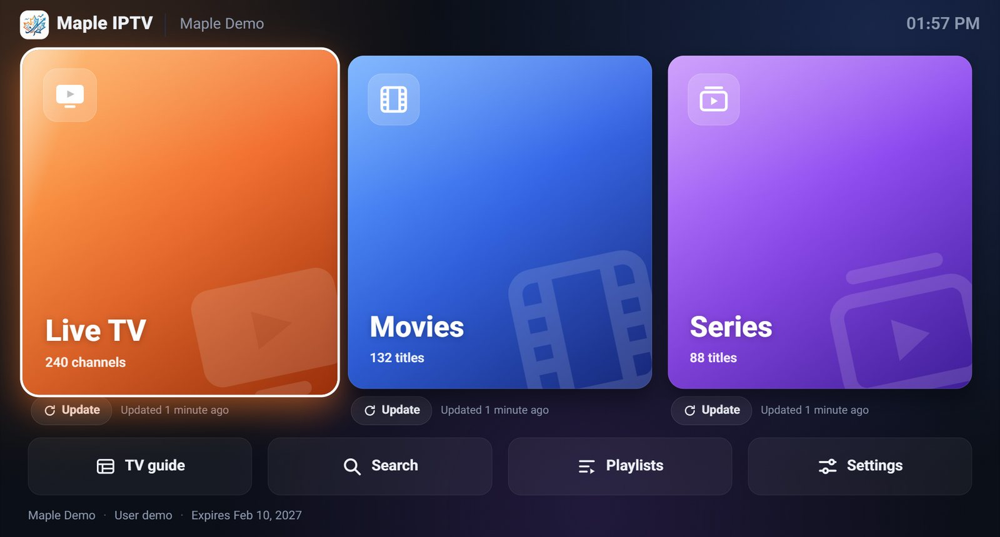

# Maple IPTV

**پخش‌کننده‌ی رایگان IPTV برای تلویزیون، گوشی و کامپیوتر.** کانال‌های زنده با راهنمای برنامه‌ها، و فیلم و سریال با پوستر، خلاصه و بازیگران، از اشتراک IPTV خودتان.

[English](README.md) · [سایت](https://mapleonlinesolutions.com/maple-iptv?lang=fa) · [همه‌ی فایل‌ها](https://github.com/davood41444/maple-iptv/releases/latest)

## دانلود

Maple IPTV رایگان است، با همه‌ی امکانات و بدون محدودیت. حساب کاربری هم لازم نیست.

| دستگاه | دانلود |
|---|---|
| تلویزیون اندروید، Google TV و Fire TV | [MapleIPTV.apk](https://github.com/davood41444/maple-iptv/releases/latest/download/MapleIPTV.apk) |
| گوشی و تبلت اندروید | [MapleIPTV.apk](https://github.com/davood41444/maple-iptv/releases/latest/download/MapleIPTV.apk) |
| ویندوز ۱۰ و ۱۱ | [MapleIPTV-Setup.exe](https://github.com/davood41444/maple-iptv/releases/latest/download/MapleIPTV-Setup.exe) |
| مک، macOS 13 یا جدیدتر | [MapleIPTV-Mac.dmg](https://github.com/davood41444/maple-iptv/releases/latest/download/MapleIPTV-Mac.dmg) |
| مک، macOS 10.13 تا 12 | [MapleIPTV-Mac-Legacy.dmg](https://github.com/davood41444/maple-iptv/releases/latest/download/MapleIPTV-Mac-Legacy.dmg) |
| لینوکس | [AppImage](https://github.com/davood41444/maple-iptv/releases/latest/download/MapleIPTV-Linux.AppImage) · [فایل deb برای اوبونتو و دبیان](https://github.com/davood41444/maple-iptv/releases/latest/download/MapleIPTV-Linux.deb) |
| تلویزیون سامسونگ | [MapleIPTV-SamsungTV.wgt](https://github.com/davood41444/maple-iptv/releases/latest/download/MapleIPTV-SamsungTV.wgt) (راهنمای نصب را ببینید) |
| آیفون و آیپد | به‌زودی |

راهنمای قدم‌به‌قدم نصب روی هر دستگاه: [راهنمای نصب](https://mapleonlinesolutions.com/maple-iptv/install?lang=fa).

## امکانات

- **تلویزیون زنده:** دسته‌بندی، علاقه‌مندی‌ها، اخیراً دیده‌شده و عوض کردن سریع کانال
- **جدول پخش:** برنامه‌های همه‌ی کانال‌ها روی یک خط زمان، و تماشای برنامه‌های گذشته وقتی سرویس‌دهنده ضبطشان کرده باشد
- **فیلم و سریال:** پوستر، خلاصه، امتیاز و بازیگران، فصل‌ها و قسمت‌ها، و ادامه‌ی تماشا
- **صدا و زیرنویس:** انتخاب زبان صدا و زیرنویس، و تنظیم اندازه، رنگ و فونت زیرنویس
- **دانلود:** ذخیره‌ی فیلم و سریال روی ویندوز، مک و لینوکس برای تماشای بدون اینترنت
- **پروفایل‌ها:** علاقه‌مندی‌ها و سابقه‌ی جدا برای هر نفر، و پروفایل کودک بدون دسته‌های بزرگسالان
- **کد پشتیبان:** انتقال پلی‌لیست‌ها و تنظیمات به دستگاه دیگر با یک کد کوتاه
- **رمز کنترل والدین:** قفل کردن دسته‌های بزرگسالان
- **به‌روزرسانی خودکار:** اپ خبر می‌دهد نسخه‌ی جدید آماده است و آن را نصب می‌کند
- **۷ زبان:** انگلیسی، فارسی، فرانسوی، اسپانیایی، عربی، چینی و ترکی

## خوب است بدانید

Maple IPTV یک پخش‌کننده است. هیچ کانالی ندارد و نمی‌فروشد. شما پلی‌لیست سرویس IPTV خودتان را اضافه می‌کنید: اطلاعات ورود Xtream Codes یا لینک M3U. رمزهای شما روی دستگاه خودتان می‌ماند.

هر فایل پیش از انتشار بررسی می‌شود، و نسخه‌های ویندوز، مک و لینوکس فقط به‌روزرسانی‌هایی را نصب می‌کنند که Maple Online Solutions امضا کرده باشد.

این صفحه برای دانلود است. کد برنامه عمومی نیست.

## تماس

Maple Online Solutions · info@mapleonlinesolutions.com

© Maple Online Solutions. همه‌ی حقوق محفوظ است.

