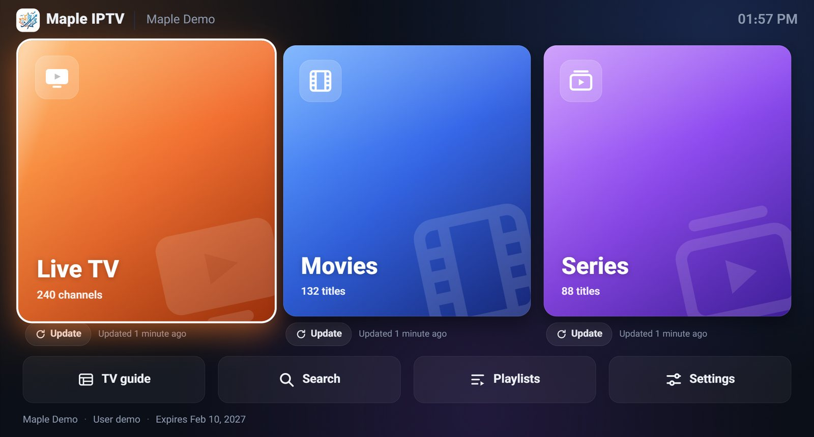
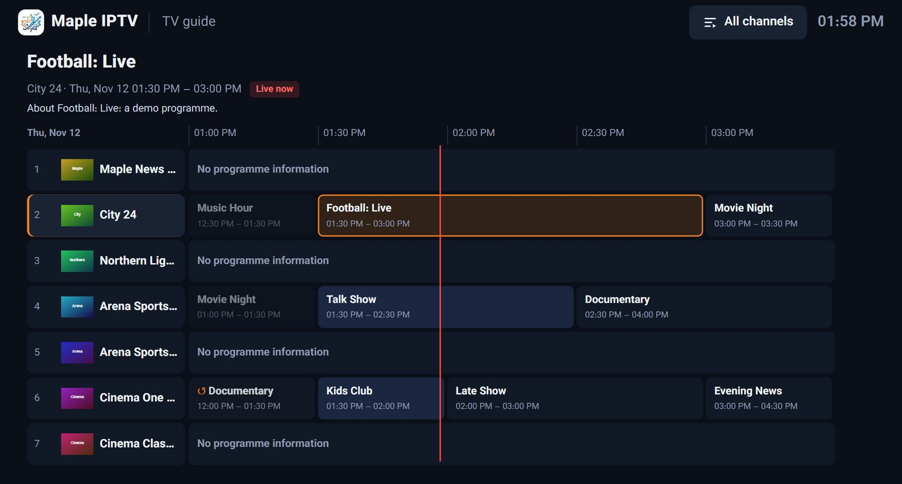
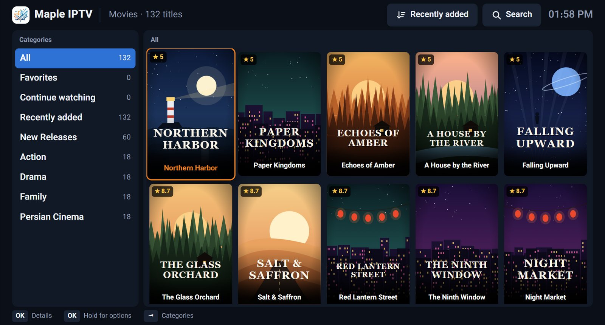

# Maple IPTV

**A free IPTV player for your TV, phone and computer.** Watch live channels with a program guide, plus movies and series with posters, plot and cast, from your own IPTV subscription.

[فارسی](README.fa.md) · [Website](https://mapleonlinesolutions.com/maple-iptv) · [All downloads](https://github.com/davood41444/maple-iptv/releases/latest)

## Download

Maple IPTV is free, with every feature and no limits. You don't need an account.

| Device | Download |
|---|---|
| Android TV, Google TV, Fire TV | [MapleIPTV.apk](https://github.com/davood41444/maple-iptv/releases/latest/download/MapleIPTV.apk) |
| Android phones and tablets | [MapleIPTV.apk](https://github.com/davood41444/maple-iptv/releases/latest/download/MapleIPTV.apk) |
| Windows 10 and 11 | [MapleIPTV-Setup.exe](https://github.com/davood41444/maple-iptv/releases/latest/download/MapleIPTV-Setup.exe) |
| Mac, macOS 13 or newer | [MapleIPTV-Mac.dmg](https://github.com/davood41444/maple-iptv/releases/latest/download/MapleIPTV-Mac.dmg) |
| Mac, macOS 10.13 to 12 | [MapleIPTV-Mac-Legacy.dmg](https://github.com/davood41444/maple-iptv/releases/latest/download/MapleIPTV-Mac-Legacy.dmg) |
| Linux | [AppImage](https://github.com/davood41444/maple-iptv/releases/latest/download/MapleIPTV-Linux.AppImage) · [.deb for Ubuntu and Debian](https://github.com/davood41444/maple-iptv/releases/latest/download/MapleIPTV-Linux.deb) |
| Samsung TV | [MapleIPTV-SamsungTV.wgt](https://github.com/davood41444/maple-iptv/releases/latest/download/MapleIPTV-SamsungTV.wgt) (see the install guide) |
| iPhone and iPad | Coming soon |

Step-by-step instructions for every device: [install guide](https://mapleonlinesolutions.com/maple-iptv/install).

## Features

- **Live TV:** categories, favorites, recently watched and fast channel switching
- **TV guide:** every channel's programs on a timeline, and catch-up of past programs when your provider records them
- **Movies and series:** posters, plot, rating and cast, seasons and episodes, and continue watching
- **Audio and subtitles:** choose the audio track and subtitles, and set the subtitle size, color and font
- **Downloads:** save movies and episodes on Windows, Mac and Linux and watch them offline
- **Profiles:** each person's own favorites and history, and kids profiles without adult categories
- **Backup codes:** move your playlists and settings to another device with a short code
- **Parental PIN:** lock adult categories
- **Automatic updates:** the app tells you when a new version is ready and installs it
- **7 languages:** English, Persian, French, Spanish, Arabic, Chinese and Turkish

 

## Good to know

Maple IPTV is a player. It doesn't include or sell any channels. You add your own playlist from your IPTV provider: an Xtream Codes login or an M3U link. Your passwords stay on your device.

Every download is checked before it's published, and the Windows, Mac and Linux apps install only updates signed by Maple Online Solutions.

This page is for downloads. The source code is not public.

## Contact

Maple Online Solutions · info@mapleonlinesolutions.com

© Maple Online Solutions. All rights reserved.
