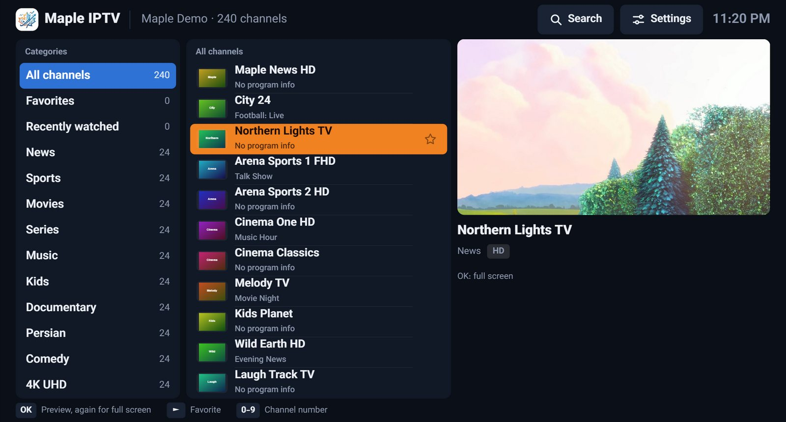

# Maple IPTV

**A free IPTV player for your TV, phone and computer.** Watch live channels with a program guide, plus movies and series with posters, plot and cast, from your own IPTV subscription.

[فارسی](README.fa.md) · [Website](https://mapleonlinesolutions.com/maple-iptv) · [All downloads](https://github.com/davood41444/maple-iptv/releases/latest)

## Download

Maple IPTV is free, with every feature and no limits. You don't need an account.

| Device | Download |
|---|---|
| Android TV, Google TV, Fire TV | [MapleIPTV.apk](https://github.com/davood41444/maple-iptv/releases/latest/download/MapleIPTV.apk) |
| Android phones and tablets | [MapleIPTV.apk](https://github.com/davood41444/maple-iptv/releases/latest/download/MapleIPTV.apk) |
| Windows 10 and 11 | [MapleIPTV-Setup.exe](https://github.com/davood41444/maple-iptv/releases/latest/download/MapleIPTV-Setup.exe) |
| Mac (Apple Silicon and Intel) | [MapleIPTV-Mac.dmg](https://github.com/davood41444/maple-iptv/releases/latest/download/MapleIPTV-Mac.dmg) |
| Linux | [AppImage](https://github.com/davood41444/maple-iptv/releases/latest/download/MapleIPTV-Linux.AppImage) · [.deb for Ubuntu and Debian](https://github.com/davood41444/maple-iptv/releases/latest/download/MapleIPTV-Linux.deb) |
| Samsung TV | On request: info@mapleonlinesolutions.com |
| iPhone and iPad | Coming soon |

Installation tips are on the [release page](https://github.com/davood41444/maple-iptv/releases/latest).

## Features

- **Live TV:** categories, favorites, recently watched, a program guide and fast channel switching
- **Movies and series:** posters, plot, rating and cast, seasons and episodes, and continue watching
- **Audio and subtitles:** choose the audio track and subtitles, and set the subtitle size, color and font
- **Downloads:** save movies and episodes on Windows, Mac and Linux and watch them offline
- **Parental PIN:** lock adult categories
- **7 languages:** English, Persian, French, Spanish, Arabic, Chinese and Turkish

 

## Good to know

Maple IPTV is a player. It doesn't include or sell any channels. You add your own playlist from your IPTV provider: an Xtream Codes login or an M3U link. Your passwords stay on your device.

## For developers

One shared interface (`web/`) runs inside a small app for each platform:
- `android/`
- `tizen/` (Samsung TV)
- `desktop/` (Windows, Mac and Linux)
- `ios/`

See [docs/BUILDING.md](docs/BUILDING.md).

## Contact

Maple Online Solutions · info@mapleonlinesolutions.com

© Maple Online Solutions. All rights reserved.
